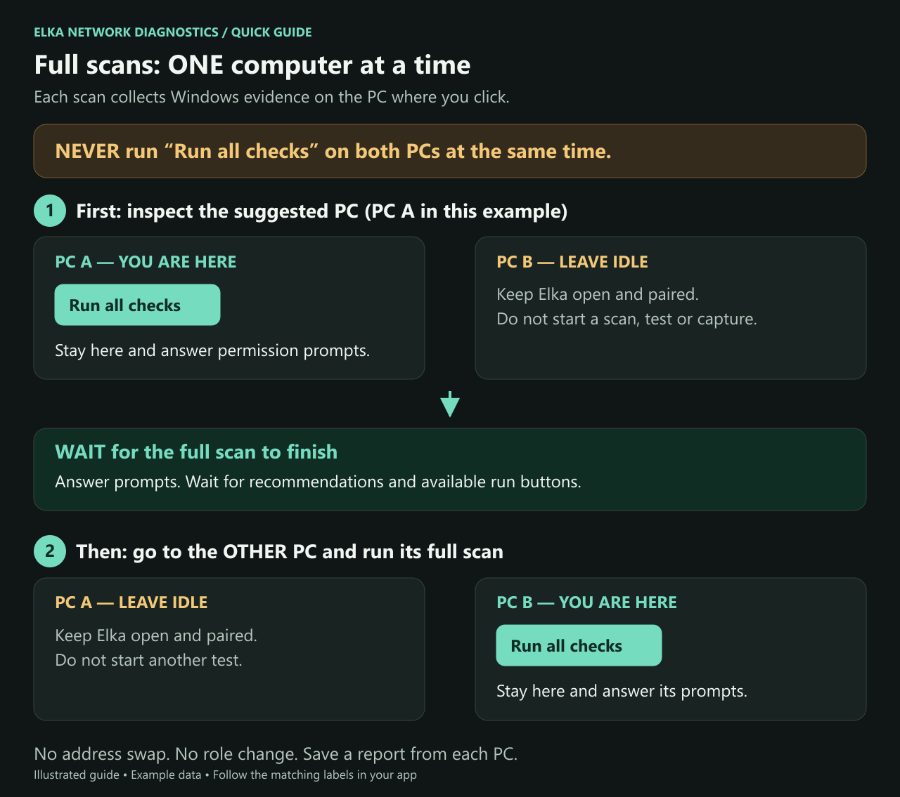

# Elka Network Diagnostics

Find out whether two Windows PCs can send and receive, then inspect the PC that needs attention. The same application runs on both computers. No reference/diagnostic role selection, server or online account is required.

**[Download the Windows app — v0.2.1](https://github.com/torment78/Elka-Network-Diagnostics/releases/download/v0.2.1/Elka-Network-Diagnostics-0.2.1-win-x64.zip)** · **[Illustrated setup guide](SETUP.md)** · [Release notes](https://github.com/torment78/Elka-Network-Diagnostics/releases/tag/v0.2.1)

This is the first public preview. Download the application ZIP above, extract the whole folder on both PCs, and open **Elka.NetworkDiagnostics.exe**. The GitHub **Source code** downloads are for the source project, not the ready-to-run app. You do not need Visual Studio or a separate .NET installation for the portable download.

For instructions with pictures, open **START-HERE.html** from the extracted folder in your browser, or read the [setup guide here on GitHub](SETUP.md).

> **Run all checks on ONE PC at a time.** Keep Elka open and paired on the other PC, but do not start another scan there. Stay at the computer running the full scan so you can respond to Windows permission and setup windows.

## Set up both computers

1. Extract the whole application ZIP on **both PCs**. Open **Elka.NetworkDiagnostics.exe** on each. Do not open the Helper executable.
2. Select the Ethernet or Wi-Fi adapter that connects each PC to your local network.
3. In **Peer connection**, enter the **other PC's** IPv4 address, or select it using **Find on LAN**.
4. Choose the pairing code shown on one PC and enter that **same complete code on both PCs**. Leave the control and test ports at their defaults unless you need to change them; they must match on both PCs.
5. Click **Start endpoint** on both PCs and wait for **Paired**. Both need version **0.2.1 or newer** for the shared check.

After restarting either app, make the pairing codes match again. You do not need to swap addresses or choose a different role when moving to the other PC.

## Run the tests in this order

| Step | What to click | What the other PC should do |
| --- | --- | --- |
| 1. Check communication | Click **Check both PCs** once, on either machine. | Join automatically. Both screens show progress and results. |
| 2. Inspect the suggested PC | On the PC suggested by the result, return to **Diagnostics** and click **Run all checks**. If no PC is identified and you need deeper checks, start with either one. | Stay open and paired. Do not start a scan or individual test. |
| 3. Wait for completion | Stay at the scanning PC and answer the Windows/admin/setup prompts. Wait for the recommendations and for the run buttons to become available again. | Continue waiting. |
| 4. Inspect the other PC | After the first scan has finished, run **Run all checks** on the other machine. | Leave the first PC open, paired and idle. |

**Never run Run all checks on both computers at the same time.** Each scan uses the other PC for traffic tests; overlapping scans can interfere with those tests and produce incomplete results.

A full scan keeps working after its initial UDP/TCP tests pass. Wait for the later Windows checks and packet captures too. Do not rely on colours alone: amber or red findings can remain after a scan has finished. Read the final status and recommendations.

## Read the result

- **Delivered / Passed:** the tested data reached the receiving application. A pass applies to the displayed addresses and test port.
- **Delivery shortfall:** some expected data was not verified at the receiver. Follow the suggested PC/direction for deeper inspection; this alone does not prove that PC caused the problem.
- **Test incomplete / Inconclusive:** the app could not finish that check. Read the reason before considering a repair.

If all four directions pass, no blocked PC was identified for that test. If your original application still has a problem, its own port and configuration may need checking. Elka's general test is not yet a VBAN audio test.

## Save results and make changes carefully

Use **Copy for support** or **Export ZIP** on each PC after its scan. Review reports before sharing; they can contain network addresses, program names and captured traffic. Pairing codes are excluded.

A full scan collects evidence and recommendations; it does not automatically run repairs. Before a network repair, use **Admin tools → Create / verify Windows restore point**, then review one proposed action at a time. Wireshark/Npcap setup does **not** require a restore point.

For permission prompts, capture-tool installation, interrupted cleanup, cancellation and connection problems, follow the [setup guide](SETUP.md).
