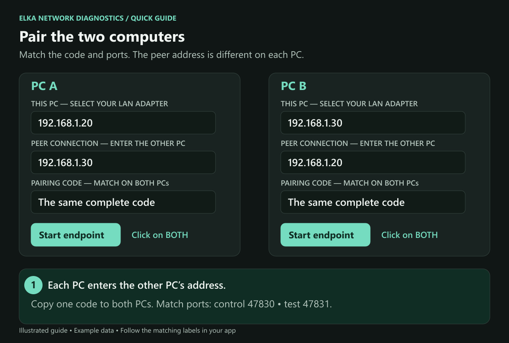
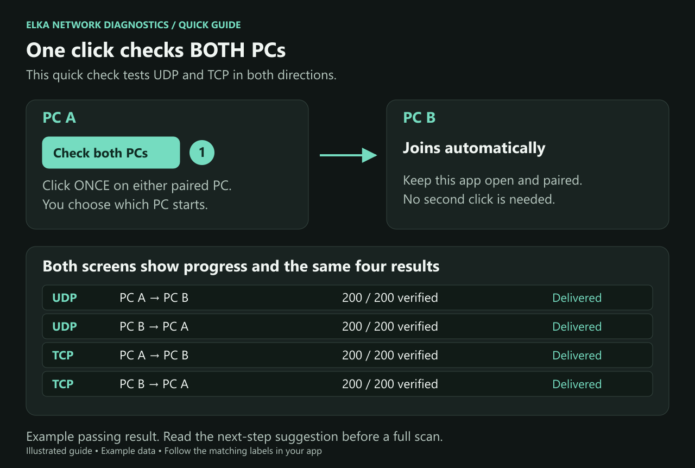
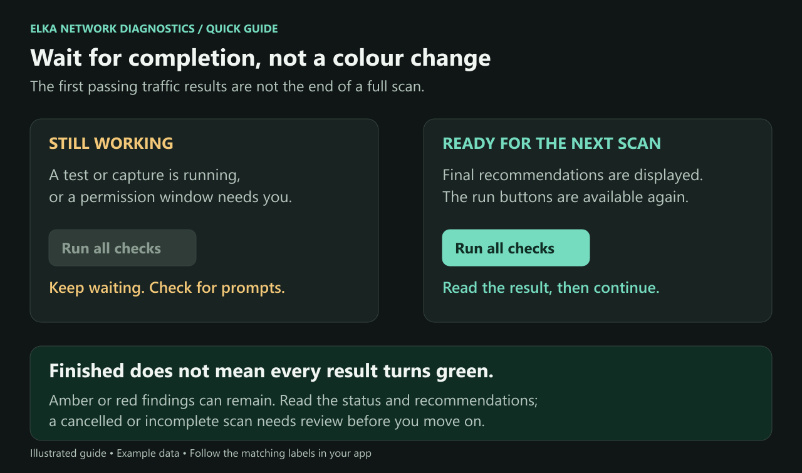

# Elka Network Diagnostics — setup and testing guide

Use this guide on both computers. It takes you from opening the app to comparing the results and deciding what to check next.

**[Download the ready-to-run Windows app](https://github.com/torment78/Elka-Network-Diagnostics/releases/download/v0.2.1/Elka-Network-Diagnostics-0.2.1-win-x64.zip).** Choose the application ZIP, not GitHub's **Source code** ZIP. After extracting, **START-HERE.html** opens this illustrated guide in your browser without a Markdown editor.

> **Run all checks on ONE PC at a time. Keep the other app open and paired, but idle. Stay at the scanning PC to answer Windows permission windows and any setup prompts.**

## 1. Open the app on both PCs

You need two 64-bit Windows PCs connected to your local network. Use the same Elka version on both; **0.2.1 or newer** is needed for the shared **Check both PCs** button. Administrator access is needed for the packet captures and repair tools.

1. Extract the **whole ZIP** into a folder on each PC. Do not run the app inside the ZIP or copy only the EXE.
2. Open **Elka.NetworkDiagnostics.exe** on each PC.
3. Do not launch **Elka.NetworkDiagnostics.Helper.exe** yourself. Elka opens it when an administrator operation needs it.
4. Under **THIS PC**, select the Ethernet or Wi-Fi adapter connected to the other computer. Note the IPv4 address beside it.

Normal testing works directly between the PCs without an internet account or server. Internet access is needed if you choose to download missing Wireshark/Npcap capture tools.

## 2. Pair the computers

For these instructions, call the computers PC A and PC B. These are just names to help with setup; neither is assumed to be working correctly.

1. On PC A, enter **PC B's address** in **Peer connection**. On PC B, enter **PC A's address**.
2. Alternatively, use **Find on LAN** to select the other computer. If discovery finds nothing, enter the address manually.
3. Choose the pairing code already displayed on **one** PC. Use **Copy**, then paste or carefully enter that **same complete code** on the other PC. Both code boxes must match. You do not need to press **New** on both computers.
4. Leave the ports at **control 47830** and **test 47831** unless you have a reason to change them. The control port must match on both PCs, and the test port must match on both PCs.
5. Click **Start endpoint** on each computer. If Windows asks about firewall access, review the application and allow access for the network you are testing.
6. Wait until both applications show **Paired**.

Example addresses only — use the actual addresses shown in your apps:

| Setting | PC A | PC B |
| --- | --- | --- |
| Address shown under THIS PC | 192.168.1.20 | 192.168.1.30 |
| Address to enter in Peer connection | 192.168.1.30 | 192.168.1.20 |
| Pairing code | The same full code | The same full code |
| Control / test ports | 47830 / 47831 | 47830 / 47831 |

Keep the pairing code private. It changes when an app starts and is not saved with your settings. **After restarting either app, make the codes match again.** To edit a locked connection setting, stop that endpoint first, correct the setting and start it again.

There is no Reference or Diagnostic role to select. When you move to the other PC to run its scan later, leave the addresses and matching code as they are.

## 3. Click Check both PCs on ONE machine

1. With both apps paired, click **Check both PCs** once on either machine.
2. **Do not click it on the second machine.** That app joins automatically.
3. Both windows open **Protocols**, show progress and collect the same four direction results: UDP each way and TCP each way.
4. Wait for **Two-PC check finished** and for the run buttons to become available again.

This check sends and receives test data on both PCs. It does not perform administrator captures or network repairs. On each screen, **This PC** means the computer you are currently looking at; **Other PC** means its partner.

## 4. Decide where to look next

Read the result above the four rows and any suggested next step.

| Result | What to do next |
| --- | --- |
| All four directions delivered | The selected addresses and test port worked. If your original application still fails, inspect that application's settings and actual flow. You can still run the full scans below to collect Windows evidence. |
| Delivery shortfall toward one PC | Start the full scan on the suggested receiving PC, then scan the other PC afterward. This is a starting point for investigation, not proof of which PC caused the loss. |
| Send/connect incomplete | Read the send or connection error. The sender, receiver or network path may need inspection. |
| Test incomplete / Inconclusive | Read why the test could not finish. Check pairing, readiness or port use as indicated; missing results do not prove dropped packets. |
| Both directions fail, or no single PC is identified | Run the full scan on either PC first, then on the other. Compare both reports. |

An ordinary Elka test passing does not verify VBAN audio, another application's port, or every possible network connection. Do not reset networking just because a capture is missing or an unrelated program still has a problem.

## 5. Run the full scan on the first PC

> **Never run Run all checks on both PCs at the same time. Do not start individual tests or captures on the other PC while a full scan is running.** The scanning PC uses the other app for traffic tests; overlapping work can interfere with those tests.

1. Go to the PC you want to inspect first. Return to its **Diagnostics** tab.
2. Leave Elka open and paired on the other PC. Leave its controls alone.
3. Click **Run all checks** on the PC being inspected.
4. **Stay at that computer.** Watch for Windows administrator permission windows, Elka's confirmation windows and any capture-tool setup offer. Read each prompt and respond if you want that operation to proceed. Running Elka as administrator does not remove every confirmation.
5. Let the scan continue through the later Windows checks and packet captures. The first UDP/TCP results appearing is **not** the end of a full scan.
6. Wait for the final **Recommendations and repair** report and for the run buttons to become available again. Read any incomplete-check messages.
7. Use **Export ZIP** to save this PC's report before continuing. You can also use **Copy for support** for a shorter text report.

The full scan inspects this PC's connectivity, ports, adapter drivers/bindings, Windows filtering and packet captures. It repeats traffic tests with the other PC during captures, then recommends next steps. It does not automatically execute a repair.

### How to tell whether it is finished

- If a test/capture is still running or the run buttons are unavailable, keep waiting.
- If a permission or installer window is waiting for an answer, the scan may be waiting for you. Check those windows before assuming it has stopped working.
- A completed full scan shows its recommendations and makes the run buttons available again. If you cancelled it, or it reports that it could not complete, read the recorded reason instead of treating it as a completed scan.
- **Do not wait for every result to turn green.** Amber/red findings can remain after the work has finished. Colours describe results; the status text and available controls tell you whether you can start the next operation.

If you decline an administrator request or cancel setup, the affected check may be listed as incomplete. That does not by itself mean the network is broken.

## 6. Run the full scan on the other PC

1. Confirm that the first PC's scan has finished and any operation/setup windows have been handled.
2. Leave the first app open and paired, with no scan or individual test running.
3. Go to the **other PC**, open **Diagnostics** and click **Run all checks** there.
4. Stay at that PC and respond to its Windows/admin/setup prompts.
5. Wait for its final recommendations, then export its report too.

You do not need to change the peer addresses or swap a role. The first full scan collected the first PC's Windows evidence; this second scan collects the other PC's evidence. The shared quick-check result does not replace those two local inspections.

## 7. If Wireshark or Npcap setup is offered

Elka offers setup when capture tools are missing. You can also open **Packet viewer → Set up Wireshark + Npcap**.

1. Read the offer and choose whether to install the tools. **No Windows restore point is required for Wireshark/Npcap setup.**
2. Stay at the computer while the installer runs. Keep **TShark** selected and include **Npcap** when offered. Complete the installer's own terms and administrator prompts.
3. Finish and close the setup wizard. If Windows requests a restart, finish that before retrying a failed capture, then reopen both apps and check pairing again.
4. When setup was opened from a scan, Elka checks the tools and resumes capture. After a manual installation, use **Refresh tools** if needed.

Each PC needs its own capture tools. Use **Npcap**, not the older WinPcap package. Cancelling Elka's waiting does not close a separate Windows driver installer; finish any open installer before trying setup again.

After capture, **Packet viewer** shows decoded packets inside Elka. Select a packet and choose **Show packet details**, or **Open in Wireshark** for the separate analyzer. A successful adapter capture does not mean every internal Windows filter has been observed.

## 8. Read findings before choosing a repair

The recommendations explain the evidence and suggest the next check. A successful test needs no reset just to make every indicator look the same.

For an indicated network repair or temporary QoS trial:

1. On the PC you intend to change, open **Admin tools**.
2. Click **Create / verify Windows restore point**, respond to the local prompts, and wait for a verified point.
3. Select one proposed action, read what it changes, then choose **Review and run with administrator access** if you want to proceed.
4. Complete any requested recovery or restart, then repeat the original failed check before making another change.

Repairs remain locked if Windows cannot verify a restore point. **Open System Protection** provides the Windows controls. If a manual point is needed, use **Copy restore point name**, create a point with that name in Windows, then return to **Create / verify Windows restore point**. Elka does not enable System Protection automatically. The app rechecks the point before a repair; starting a new diagnostic session requires a point for that session.

**Open System Restore** opens Windows' recovery wizard if you later need it. Opening the wizard does not apply a restore. Keep separate backups of personal files; a restore point is not a personal-file backup or a guarantee that every change can be undone.

### If an earlier operation needs cleanup

On the PC displaying **Finish pending cleanup first**, choose **Admin tools → Restore pending change** and respond to its local prompts. Wait for verified restoration before retrying the capture or repair. Pending WFP audit cleanup is not a request to reset the network or run System Restore.

After a network reset that requires a reboot, restart Windows manually, use **Acknowledge reboot and retest**, then repeat the checks. Elka does not automatically repeat a reset.

## If pairing or a check cannot finish

Check that both apps are open, the selected adapters have the expected IPv4 addresses, each peer field names the other PC, and the pairing codes and ports match. Check the PCs' clocks too. Discovery can fail even when entering the address manually works.

If the other PC is busy, wait for its current operation to finish. If a test port is occupied, inspect **Ports and applications** before deciding to close the program using it. Do not close unrelated applications just to make a test pass.

**Cancel** stops a shared quick check from either PC and keeps completed direction results. If all communication disappears, the waiting PC stops waiting after 90 seconds without progress and keeps what it received. Unfinished directions remain unmeasured. A full scan or administrator operation may need to complete its cleanup; do not force-close it just because results have appeared.

If the PCs cannot pair at all, each can still collect local evidence and export it. **Import** lets you read the other PC's exported report alongside local evidence. The traffic tests will remain incomplete until coordination is available.

## Reports and packet findings

**Copy for support** gives you text to review and share. **Export ZIP** includes the fuller report and available captures. Reports can contain local addresses, program names, security information and captured traffic. Pairing codes are excluded. Keep the two PCs' reports identifiable when sending them to someone for help.

Use **Packet path** to inspect a direction and test run. **Not observed** describes a missing observation; it is not proof that the packet stopped there. A later retest and an earlier PktMon capture may have separate entries, so select the PktMon entry to inspect its recorded component observations. Missing capture evidence does not turn a verified delivery into a failure.

Settings and saved evidence are kept under `%LOCALAPPDATA%\ElkaSoft\NetworkDiagnostics`. Reopening the app retains saved evidence, but you still need matching pairing codes for new tests. Export before using **New session** if you want to keep the previous report. The export's `captures-manifest.txt` lists any capture files omitted because of size or count limits.

VBAN audio testing, automatic mapping through every Windows layer and connected AI assistance are not included in this release. Use the displayed evidence and recommendations to choose the next check.
